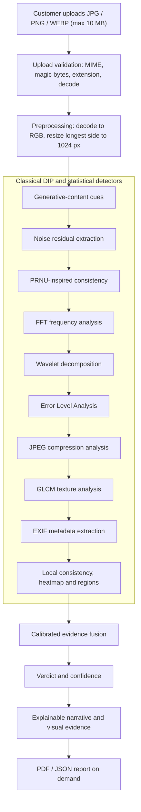

# PixelForensics

### See the Noise. Verify the Image.

PixelForensics is a web-based **digital image forensics** application. A user uploads a photograph,
the system analyses it with several classical Digital Image Processing (DIP) techniques, and the
evidence is combined into an explainable assessment of whether the image looks like a real camera
capture or like AI-generated / manipulated content.

The project was built to answer a practical question: **can an image-authenticity tool show its
work instead of returning an unexplained label?** Every result can be traced back to measurable
signals such as sensor noise, frequency energy, wavelet sub-bands, texture statistics, compression
artefacts, metadata and local noise inconsistencies. The same signals are presented as images and
plain-English explanations, and the result can be downloaded as a PDF or JSON report.

The tagline **"See the Noise. Verify the Image."** summarises the idea. Camera sensors leave a
faint, characteristic noise pattern; generated or heavily processed images often do not. Making
that invisible signal visible allows a reader to inspect the evidence rather than simply trust a
score.

---

## Demo Website Access

> These credentials are provided **for teacher evaluation and demonstration purposes only**.

| Item | Value |
|---|---|
| **Website URL** | `https://YOUR-DEPLOYED-PIXELFORENSICS-URL` *(placeholder — replace with the deployed site URL)* |
| **Admin Login Page** | `https://YOUR-DEPLOYED-PIXELFORENSICS-URL/login` |
| **Admin Email** | `admin@pixelforensics.com` |
| **Admin Password** | `********` *(placeholder — replace with your actual admin password)* |

The repository does not contain a deployed website URL, so the URL above is a clearly marked
placeholder. It must be replaced with the real address once the project is hosted.

The demo admin account is the one the backend seeds automatically **only when the database does
not already contain an ADMIN account**. On a deployment that uses an existing database, the
administrator credentials configured for that deployment should be used instead. The same demo
details are displayed on the application's Login page. They must be changed before any public or
production use.

**No fixed customer demo account is seeded.** A teacher who wants to test the customer workflow
should create a new customer account through **Sign Up** (see Section 6).

Security note: this README intentionally contains **no** database passwords, Supabase
service-role keys, JWT secrets, API keys or production credentials. Real secrets belong in
environment files that are not committed to the repository.

---

## 1. Project Overview

### What the project is

PixelForensics is a full-stack application with:

- a **React + TypeScript** single-page frontend,
- a **FastAPI** backend,
- a **SQLite** database by default, with optional **Supabase PostgreSQL** support,
- a forensic analysis pipeline made of ten detectors,
- a calibrated evidence-fusion layer,
- an explainable narrative generator, and
- a professional PDF / JSON reporting module.

A customer registers, uploads an image, runs an analysis, explores the evidence and downloads a
report. An administrator sees platform-level statistics, verdict distributions, the user list and
system-health information.

### The problem it addresses

AI image generators and image-editing tools are widely available, while most "AI detectors" give a
single opaque score. In addition, a forensic examiner usually has only one image and no reference
photograph from the same camera. PixelForensics addresses this by measuring several independent
signals, reporting each one honestly, and combining them into a cautious verdict.

Digital image forensics helps here because manipulation and synthesis tend to disturb measurable
properties of an image: sensor noise, frequency balance, micro-texture, compression history and
metadata. These properties can be visualised and explained, which makes the result more useful
than a bare label.

### Verdicts produced by the application

| Verdict | Meaning |
|---|---|
| **Likely Real** | The combined evidence is more consistent with a camera-captured photograph. |
| **Likely AI Generated / Manipulated** | The combined evidence suggests synthetic generation or manipulation. |
| **Inconclusive** | The evidence is mixed or insufficient. This is an honest outcome, not a system error. |

Every verdict is an **evidence-based assessment, not a guarantee of authenticity**. A determined
generator, strong denoising, recompression or careful editing can remove or imitate the traces the
pipeline looks for.

### Why the project is useful

- It makes forensic evidence **visible**: noise residuals, heatmaps, FFT spectra, wavelet bands and
  ELA maps are shown to the user.
- It explains **why** a verdict was reached, including evidence that points the other way.
- It separates customer and administrator roles and keeps each customer's analyses private.
- It produces a **signed, professional PDF report** suitable for demonstration or coursework.
- It is deliberately transparent: the complete decision path can be inspected in the source code.

---

## 2. Technologies and Tools Used

| Category | Technology / Tool |
|---|---|
| Frontend framework and language | **React 18** with **TypeScript** — component-based single-page application |
| Build tool | **Vite 5** — development server and production bundler |
| Styling | **Tailwind CSS 3** plus custom CSS — responsive dark/light interface |
| Routing | **React Router 6** — public pages, guarded customer routes and an admin-only route |
| Animation | **Framer Motion** — page reveals and interface transitions |
| Icons | **Lucide React** — interface icons |
| Charts | **Recharts** — admin verdict pie chart and bar chart |
| Supabase client | **@supabase/supabase-js** — optional Supabase Auth session in the frontend |
| Backend framework | **FastAPI** — REST API under `/api/*` |
| Backend language and runtime | **Python 3.11+** with **Uvicorn** as the ASGI server |
| Validation and configuration | **Pydantic v2**, **pydantic-settings**, **python-multipart**, **email-validator** |
| Database | **SQLite** (default, via `aiosqlite`) or **PostgreSQL / Supabase** (optional) |
| ORM | **SQLAlchemy 2** with async sessions; **asyncpg** for PostgreSQL |
| Authentication | Local **JWT (HS256)** with `python-jose`, **bcrypt** password hashing through `passlib`, and optional **Supabase Auth** tokens validated as RS256/ES256 through JWKS with `PyJWT` and `cryptography` |
| Image processing | **OpenCV** (`opencv-python`) and **Pillow** — decoding, resizing, filtering, colour maps, EXIF access, JPEG re-encoding |
| Numerical computing | **NumPy** — arrays, statistics, FFT and matrix operations |
| Wavelet analysis | **PyWavelets** — wavelet denoising and LL/LH/HL/HH decomposition |
| Texture analysis | **scikit-image** — GLCM (`graycomatrix`, `graycoprops`) |
| Report generation | **ReportLab** — branded multi-page PDF reports |
| Report integrity | Python standard-library **`hmac`** and **`hashlib`** — HMAC-SHA256 report signature |
| Rate limiting | **slowapi** — configured in the backend (see the note in Section 10) |
| Testing | **pytest** and **pytest-asyncio** (backend), **Vitest** (frontend) |
| External media | **Unsplash** — decorative photographs on the public landing and login pages only |
| Development tooling | **npm**, **pip** and Python virtual environments for dependency management |

> Several packages appear in `backend/requirements.txt` but are **not imported by the application
> code** — for example `scipy`, `imageio` and `piexif`. They are therefore not listed as technologies
> used by the project. No Matplotlib, CNN framework or external AI API is used.

---

## 3. Digital Image Processing and Forensic Techniques

The pipeline contains ten detectors. Each returns a score from `0` to `1`, where a **higher score
means more camera-like** and a **lower score means more synthetic or unusual**. The scores carry
different weights, explained in Section 3.13.

### 3.1 Digital Image Processing (DIP)

DIP analyses and manipulates images using mathematical operations rather than learned models.
Pixels are treated as numerical arrays, and filters, transforms and statistics reveal properties
that are not obvious to the eye.

**Role:** DIP is the foundation of the whole pipeline — grayscale conversion, resizing, median and
Sobel filtering, wavelet transforms, FFT, GLCM, JPEG recompression and colour-map generation.

### 3.2 Generative-Content Cue Analysis

This is a **statistical detector**, not a trained neural network. It combines six weighted cues:
noise-residual **kurtosis** (heavy tails can indicate upsampling or oversharpening), the **noise
floor in flat regions** (real captures keep grain; generated images are often too clean), the
**detail floor** across quiet 16×16 blocks, mean **saturation**, horizontal **autocorrelation** of
the residual, and an **encoder/metadata prior** (EXIF camera make/model, generator software tags,
embedded prompt text, common generative output sizes, and PNG-versus-JPEG priors).

**Evidence and role:** It examines noise character, flat-area texture, colour behaviour and file
metadata. This is the `GENERATIVE` detector and carries the largest weight (66%) in the decision.

### 3.3 Noise Residual Extraction

The grayscale image is denoised with a **Daubechies `db8` wavelet** at level 2, using a
BayesShrink-style soft threshold on the detail coefficients. Subtracting the denoised image leaves
the noise residual; its variance and median absolute deviation (MAD) are measured.

**Evidence and role:** The strength of the sensor-noise floor. Camera images usually retain moderate
residual energy, while synthetic or heavily denoised images often do not. This produces the
`NOISE_RESIDUAL` detector and the residual map shown in the interface; the same residual is reused
by PRNU, FFT and local-consistency analysis.

### 3.4 Wavelet Decomposition and Denoising

A single-level **Daubechies `db4`** transform splits the image into **LL** (approximation), **LH**
(horizontal detail), **HL** (vertical detail) and **HH** (diagonal detail) sub-bands. The energy in
each band is measured and compared with the distribution expected from a natural photograph.

**Evidence and role:** Whether detail energy is spread naturally or is over-smooth / spiky, which
can indicate synthesis or aggressive processing. This produces the `WAVELET` detector and the four
sub-band thumbnails shown in the **Forensic** tab and PDF.

### 3.5 PRNU-Inspired Noise Analysis

**Photo-Response Non-Uniformity (PRNU)** is the fixed, pixel-level sensitivity variation of a camera
sensor, acting like a weak sensor fingerprint. With one image and no reference frames, the system
cannot extract a known camera fingerprint. Instead it checks whether the residual behaves like raw
sensor noise using lag-1 **spatial autocorrelation**, **block-variance uniformity** across an 8×8
grid, and residual **energy**.

**Evidence and role:** Whether the noise is internally consistent with camera sensor noise. This is
the `PRNU` detector and is **supporting evidence only**. It does not identify a particular camera
and does not independently prove that an image is AI-generated; same-camera proof needs reference
frames.

### 3.6 Fast Fourier Transform (FFT) Frequency-Domain Analysis

The residual is transformed with `np.fft.fft2` and shifted so low frequencies sit at the centre. It
is split into radial bands; the pipeline compares low-, mid- and high-frequency energy, measures the
high-frequency ratio, and checks how peaky the radially averaged spectrum is.

**Evidence and role:** Periodic peaks, banding or an unusual energy balance caused by resampling,
compression or synthesis. This produces the `FREQUENCY` detector and a 64×64 spectrum image.

### 3.7 Gray-Level Co-occurrence Matrix (GLCM) Texture Analysis

GLCM measures how often pairs of pixel intensities occur at given distances and directions. The
image is resized to 256×256, quantised to 8 grey levels, and co-occurrence matrices are built at
distances 1–2 and four angles; **contrast**, **homogeneity**, **energy** and **correlation** are
averaged.

**Evidence and role:** Micro-texture. Natural photographs tend to have busy, irregular texture;
synthetic or heavily smoothed images can be unusually homogeneous. This produces the `TEXTURE`
detector.

### 3.8 Error Level Analysis (ELA)

The image is re-saved as JPEG at quality 90, and the absolute difference from the original is
measured (mean and standard deviation). Edited regions often respond differently to recompression.

**Evidence and role:** Localised compression-response differences that may indicate editing. This
produces the `ELA` detector and visualisation. It is **format-gated to JPEG** and carries a small
weight because it is sensitive to recompression history.

### 3.9 JPEG Compression Analysis

The pipeline measures **block-boundary energy** across 8×8 grid lines, checks whether recompressed
file sizes change monotonically at qualities 60, 75 and 90, and performs a quality-70 **ghost
correlation** check.

**Evidence and role:** Blocking artefacts and an inconsistent or double-compression history. This
produces the `JPEG` detector. Like ELA, it is format-gated to JPEG and carries a small weight.

### 3.10 EXIF Metadata Analysis

Pillow reads EXIF tags and records file name, MIME type, size, dimensions, colour mode, camera make
and model, capture date, software and GPS presence.

**Evidence and role:** Whether the file carries camera-style metadata, generator software tags or no
metadata. Metadata is easy to strip or forge, so it is **supporting evidence only**. This produces
the `METADATA` detector and the **Metadata** tab. GPS coordinates are never displayed; only their
presence is reported.

### 3.11 Local Noise Consistency, Heatmap and Suspicious Regions

The image is resized to a 12×12 grid, and each cell's residual variance is compared with the median.
The log-ratio deviation becomes an anomaly map, which is upscaled and rendered as a **JET colour
heatmap**. Connected components of high-anomaly cells become suspicious regions, limited to five
boxes.

**Evidence and role:** Localised noise differences that may indicate pasted, cloned or repainted
areas. This produces the `LOCAL` detector, the **Heatmap (Suspicious Areas)** with an on/off toggle
and opacity slider, and the **Suspicious Regions** list.

### 3.12 Cross-Correlation for Image Comparison

Each image is resized, its residual is extracted, zero-meaned and normalised. The residual
fingerprints are cropped to a common size and compared pairwise using a mean product
(cross-correlation).

**Evidence and role:** Whether images may share a source or processing pipeline. This powers the
**Compare Camera Fingerprints** page for 2–4 images, which labels the outcome `SIMILAR_SOURCE`,
`DIFFERENT_SOURCE` or `INCONCLUSIVE`. It is indicative only, not proof of a shared camera.

### 3.13 Evidence Aggregation and Calibrated Scoring

A raw average would pull every result toward the middle, because detectors have different baselines
and some do not apply to every format. Instead, each score becomes calibrated evidence:

```text
e_i      = clip((score_i - centre_i) × gain_i, -1, +1)
evidence = Σ (weight_i × e_i) / Σ weight_i
final    = sigmoid(3.0 × evidence)
```

| Detector | Weight |
|---|---:|
| Generative-content cues | 0.66 |
| Sensor-noise floor | 0.12 |
| PRNU consistency | 0.05 |
| Local noise consistency | 0.05 |
| GLCM texture | 0.04 |
| Frequency domain | 0.03 |
| Wavelet bands | 0.02 |
| ELA | 0.01 |
| JPEG compression | 0.01 |
| Metadata | 0.01 |

**Verdict thresholds:** `final ≥ 0.60` → **Likely Real**; `final < 0.45` → **Likely AI Generated /
Manipulated**; between the two → **Inconclusive**.

**Confidence** is `min(0.97, 0.50 + 1.5 × |final − 0.50|)`. It expresses distance from the decision
boundary, **not** a calibrated probability that the image is authentic. This module also names the
strongest evidence for and against the verdict.

### 3.14 Explainable Narrative

The narrative is generated deterministically from the stored result JSON. It contains a headline,
summary, key findings, numbered sections, per-detector readings, next steps and a limitations note,
and can be regenerated for older analyses. It supplies the **Explainable AI** tab and the narrative
sections of the PDF report.

---

## 4. Machine Learning / AI Component

**PixelForensics does not use a trained machine-learning model.**

There is:

- no CNN or transformer classifier,
- no downloaded model weights,
- no training loop,
- no external AI detection API, and
- no reported training or test accuracy.

The module labelled **"AI-content cues"** in the interface is a **hand-designed statistical
detector** (Section 3.2). It measures noise, texture, colour and metadata properties and combines
them with fixed weights. The name refers to the *content it looks for*, not to a learned model.

The backend includes `backend/tools/calibrate.py`. This tool runs the real pipeline over a small
labelled folder of camera and generated images, reports per-detector ranking statistics, and
prints suggested `WEIGHTS` and `CALIBRATION` values. It **does not train or save a model**; it only
helps tune the evidence-fusion parameters. The sample set is a calibration aid, not a training
dataset.

This design was chosen deliberately: every decision can be traced to an explainable measurement,
and the project can run without a GPU or a model download.

---

## 5. Main Features

- **Customer registration and login** — username or email sign-in, with optional Supabase Auth.
- **Role-based access** — customers reach the customer dashboard; administrators reach `/admin`.
  Roles are assigned and enforced by the backend, never by the browser.
- **Image upload and validation** — JPG, PNG and WEBP up to 10 MB, with MIME, magic-byte,
  extension and decode checks.
- **Automated forensic analysis** — ten detectors covering generative cues, noise, PRNU, FFT,
  wavelets, ELA, JPEG, GLCM, metadata and local consistency.
- **Three verdicts with confidence** — Likely Real, Likely AI Generated / Manipulated, or
  Inconclusive.
- **Visual evidence** — original preview, noise residual map, anomaly heatmap with opacity control,
  frequency spectrum, ELA map and wavelet sub-bands.
- **Explainable results** — headline, summary, key findings, numbered sections, detector readings,
  next steps and limitations.
- **Detector breakdown** — each detector's score, weight, interpretation and whether it applied to
  the file format.
- **Suspicious-region list** — coordinates, size and reason for each flagged region.
- **Analysis history** — searchable list with **Open** and **Delete** actions.
- **PDF report** — branded, multi-page report with visual exhibits and an HMAC-SHA256 signature.
- **JSON report** — complete structured analysis data.
- **Image comparison** — compare 2–4 images using residual cross-correlation.
- **Customer profile page** — read-only username, email and role.
- **Admin dashboard** — totals, verdict charts, user list, system health and storage/disk status.
- **Dark/light theme toggle** — available in the public navigation bar.

The application does **not** provide account editing, password reset, admin user-management actions
(delete/disable/edit), or a customer-impersonation feature.

---

## 6. How to Access the Customer View

A customer account must be created first; no fixed customer demo account is seeded.

1. Open the deployed PixelForensics website.
2. On the landing page, click **Sign Up** in the top navigation bar, **Get Started**, or
   **Analyze an Image**.
3. On the Login page, select the **Sign Up** tab.
4. Register with:
   - **Username** — 3–32 characters using letters, numbers, `.`, `_` or `-`.
   - **Email** — a valid email address.
   - **Password** — at least 8 characters with upper case, lower case, a number and a special
     character.
   - **Confirm Password** — must match.
5. Click **Create Account →**. The backend assigns the `CUSTOMER` role automatically and the
   browser opens the customer dashboard.
6. An existing customer can instead open the website, click **Sign In**, enter **Email or
   Username** and **Password**, and click **Sign In →**.

> If the deployment uses Supabase Auth with email confirmation enabled, the application may ask
> you to confirm your email address before the first sign-in.

After login, the customer dashboard contains:

- A welcome banner: **"Welcome back, *username*!"**
- Four summary cards: **Total analyses**, **Likely Real**, **Flagged**, **Inconclusive**.
- A **Recent analyses** list; selecting an entry opens its report.
- A **+ New Image Analysis** button.
- A left sidebar with **Dashboard**, **New Analysis**, **History**, **Compare Images**, **Profile**
  and **Logout**.

The **Profile** page simply displays the username, email and server-enforced role. It is not an
editable settings page.

---

## 7. How to Use PixelForensics for Image Analysis

1. **Log in as a customer** using the steps in Section 6.
2. Open the analysis page by clicking **New Analysis** in the sidebar, or **+ New Image Analysis**
   on the dashboard.
3. **Select an image** by dragging and dropping it onto the upload area, or by clicking
   **Browse Files**.
4. **Supported files:** **JPG**, **PNG** and **WEBP**, with a maximum size of **10 MB**. The
   frontend checks the type and size, and the backend repeats the check with MIME sniffing, magic
   bytes, extension agreement and a real image decode.
5. **Start the analysis** by clicking **Analyze**. While it runs, the button reads
   **"Analyzing..."**.
6. A panel titled **"Forensic pipeline running..."** lists the stages:
   Image validation, Metadata extraction, AI-content cue scan, Noise residual extraction, PRNU
   analysis, Frequency-domain analysis, Wavelet decomposition, Compression analysis, ELA analysis,
   Local consistency analysis, Forensic score aggregation, and Report generation.
7. **Wait for completion.** Processing normally takes a few seconds, depending on image size and
   server load. When finished, the report page opens automatically.
8. **Read the final verdict.** The coloured banner shows **Likely Real**, **Likely AI Generated /
   Manipulated** or **Inconclusive**, together with a short explanation and a confidence meter.
9. **Interpret the numbers correctly:**
   - The **final score** is a camera-likeness score from `0` to `1`; higher means more camera-like.
   - The **confidence** shows distance from the decision boundary. It is not the probability that
     the image is real.
   - Each **detector score** is also camera-likeness. Rows marked **"not applicable"** abstained
     (for example, ELA and JPEG analysis on a PNG).
10. **Inspect the technical evidence.** The **Forensic** tab contains the **Detector vote
    breakdown**, with a bar and interpretation for every detector. Available detectors are shown at
    full opacity; non-applicable ones are greyed out.
11. **Explore the visual outputs** in the **Visual Analysis** tab:
    - **Original Image** (shown when the report opens right after analysis; reopening from
      **History** later may not show it, because the local file is no longer held in the browser),
    - **Noise Residual Map**,
    - **Heatmap (Suspicious Areas)** with a **Heatmap ON/OFF** checkbox and an opacity slider,
    - **Frequency Spectrum**.

    The **Forensic** tab additionally shows the **ELA** image (JPEG sources) and **Wavelet LL / LH /
    HL / HH** sub-bands. The **Suspicious Regions** list appears below the tabs.
12. **Read the detailed explanation.** Open the **Explainable AI** tab to see the headline, summary,
    key findings, numbered explanation sections, a **"How each detector was read"** table,
    **"What to do next"**, and the limitations note.
13. **Open the analysis history.** Click **History** in the sidebar to reach **My Analysis
    History**. The search box filters by filename. Each row has **Open** and **Delete** buttons.
14. **Download the PDF report.** On the report page, click **Download Report** in the top-right
    area. The server supplies a meaningful filename such as
    `Beach-Sunset-Forensic-Report.pdf`, and the file is saved to the browser's normal **Downloads**
    folder unless the browser is configured to ask for a location.
15. **Download the JSON report.** Click **JSON**, next to **Download Report** on the same page. It
    downloads the complete structured analysis with the same naming convention.
16. **About the original image:** the application displays an **Original Image** preview but does
    **not** provide a dedicated button to download the original uploaded file. The **Download
    Report** and **JSON** buttons download the *analysis report*, not the original image.

Reports can also be downloaded after reopening an analysis from **History**. Every download is
restricted to the owner of that analysis.

### Report contents

The **PDF report** is a branded, multi-page A4 document containing:

- a cover page with the PixelForensics branding, verdict, score, analysis ID, dates and the
  analysed frame;
- narrative sections on the image description, method, decisive evidence, counter-evidence,
  localised anomalies, noise/sensor findings, frequency and wavelet findings, compression,
  metadata, detector agreement, limitations, conclusion and next steps;
- a metrics table and a detector breakdown table;
- visual exhibits **A–G**: submitted frame, flagged regions, noise residual, anomaly heatmap, ELA,
  frequency spectrum and wavelet sub-bands;
- a suspicious-region table;
- an **Authenticity and digital signature** block with the HMAC-SHA256 signature ID;
- a diagonal watermark, header/footer and page numbers.

The **JSON report** contains the full structured analysis: verdict, scores, detector outputs,
breakdown, regions, image information, artifacts and the narrative.

---

## 8. Admin Dashboard: How the Teacher Can View Customers

1. Open the deployed PixelForensics website.
2. Go to the login page (`/login`).
3. Enter the demo admin email and password from the **Demo Website Access** section at the top of
   this README.
4. Click **Sign In →**. The backend recognises the `ADMIN` role and redirects to **Admin
   Dashboard** (`/admin`).
5. The dashboard shows four summary tiles: **Total users**, **Total analyses**, **Avg processing
   (s)** and **Algorithm**.
6. The **Verdict distribution** pie chart and **Verdict counts** bar chart summarise all analyses
   across the platform (Real, Flagged, Inconclusive).
7. The **Users (*n*)** section lists accounts with **username · email · role · status**. It is a
   read-only list, ordered by newest account first, and shows up to 200 accounts. There is **no
   search box and no customer-selection action**.
8. The administrator can see aggregate counts and verdict statistics, but **cannot open another
   customer's analysis history or reports** from the admin dashboard. Analysis detail and report
   endpoints check ownership, so a customer's private evidence is not exposed to the admin through
   the interface.
9. **System health** reports API status, database connectivity and latency, storage-folder
   writability, file count and size, free disk space, disk-usage percentage, analyses stored,
   average processing time and the storage path. Use the **Re-check** button to refresh.
10. **Customer view:** the **Customer view** button in the top-right opens the normal customer
    dashboard (`/dashboard`). This is **not impersonation**. It uses the administrator's own
    session, so it shows only the administrator's own analyses and history. To experience the real
    customer workflow, click **Logout**, then **Sign Up** and create a customer account.

Useful admin sections at a glance:

- **Summary tiles** — users, analyses, average processing time, algorithm version.
- **Verdict distribution / counts** — pie and bar charts.
- **System health** — API, database, storage and disk tiles with a **Re-check** button.
- **Users** — read-only account list.
- **Customer view** — opens the customer UI with the admin's own session.
- **Logout** — ends the session.

---

## 9. Analysis Workflow and System Architecture

### 9.1 End-to-end workflow



The diagram shows the conceptual order. In the code, the pipeline calls the detectors in a fixed
sequence and reuses the extracted residual where needed. **No machine-learning classification stage
exists.**

### 9.2 Request flow

```text
Browser (React)
   │  JWT in Authorization header (local HS256 or Supabase RS256)
   ▼
FastAPI  ──►  validation  ──►  forensic pipeline  ──►  SQLite / PostgreSQL
   │                                                      │
   └──────────────  JSON result / PDF report  ◄───────────┘
```

### 9.3 Important folders and files

```text
project12345/
├── frontend/
│   ├── src/
│   │   ├── App.tsx                  Routes and role-based Guard
│   │   ├── pages/
│   │   │   ├── Landing.tsx          Public landing page
│   │   │   ├── Login.tsx            Sign in / sign up
│   │   │   ├── Dashboard.tsx        Dashboard, New Analysis, History, Profile
│   │   │   ├── Report.tsx           Result page and download buttons
│   │   │   ├── ReportPanels.tsx     Visual, Metadata, Forensic, Explainable tabs
│   │   │   ├── Compare.tsx          Compare Camera Fingerprints
│   │   │   └── Admin.tsx            Admin Dashboard
│   │   ├── components/              Navbar, UploadZone, AnalysisProgress, etc.
│   │   ├── layouts/                 DashboardLayout with sidebar
│   │   ├── services/                auth.tsx, supabase.ts, theme.tsx
│   │   └── types/index.ts           API types and verdict labels
│   └── package.json
│
├── backend/
│   ├── app/
│   │   ├── main.py                  App setup, CORS, security headers, health, admin seed
│   │   ├── api/
│   │   │   ├── auth.py              register, login, me, sync
│   │   │   └── analysis.py          analyze, history, detail, delete, compare, reports, admin
│   │   ├── core/                    config.py, database.py, security.py
│   │   ├── forensic/
│   │   │   ├── pipeline.py          Orchestrates all detectors and comparison
│   │   │   ├── generative.py        Statistical AI-content cues
│   │   │   ├── noise_residual.py    Wavelet denoising and residual extraction
│   │   │   ├── prnu.py              PRNU-inspired consistency
│   │   │   ├── frequency_analysis.py FFT analysis
│   │   │   ├── wavelet_analysis.py  LL/LH/HL/HH energies
│   │   │   ├── ela.py               Error Level Analysis
│   │   │   ├── jpeg_analysis.py     JPEG compression analysis
│   │   │   ├── cooccurrence.py      GLCM texture analysis
│   │   │   ├── metadata.py          EXIF extraction
│   │   │   ├── suspicious_regions.py Heatmap and region detection
│   │   │   ├── scoring.py           Weights, calibration, thresholds
│   │   │   ├── narrative.py         Plain-English explanation
│   │   │   └── image_profile.py     Descriptive scene profile for report naming
│   │   ├── models/models.py         Profile, Analysis, AnalysisResult, SuspiciousRegion, AuditLog
│   │   ├── reports/                 pdf.py, naming.py, signing.py
│   │   ├── schemas/schemas.py       Pydantic request/response models
│   │   └── security/                deps.py (auth dependencies), uploads.py (validation)
│   ├── tools/calibrate.py           Tunes weights and centres from labelled samples
│   ├── dataset/                     Optional calibration images (real/ and ai/)
│   └── requirements.txt
│
├── supabase/migrations/             PostgreSQL schema and Row Level Security policies
├── docs/                            Architecture, methodology, security, API and database notes
└── tests/                           Backend tests for scoring, schemas, uploads and isolation
```

### 9.4 Storage model

Uploaded files are stored under the server's storage directory as:

```text
storage/<user_id>/<uuid>.<extension>
```

The original filename is kept in the database for display, but it is **not** used as the storage
path. This prevents path traversal and makes another user's file difficult to guess. The directory
name is the owner's ID, and every detail/report query also filters by the authenticated user.

### 9.5 Database tables

| Table | Purpose |
|---|---|
| `profiles` | User ID, username, email, password hash, role and status |
| `analyses` | Analysis metadata: owner, filename, storage path, MIME type, size, status, verdict, confidence, final score, timing |
| `analysis_results` | Full analysis JSON for each analysis |
| `suspicious_regions` | Coordinates and reason for each flagged region |
| `audit_logs` | Registration, login and sync events |

---

## 10. Security and Privacy

### Authentication

- Local accounts use **bcrypt** password hashes through `passlib`.
- Successful sign-in returns a **JWT** signed with HS256 and a configurable expiry.
- Supabase Auth can be used instead; the backend validates Supabase tokens using HS256 legacy
  secrets or RS256/ES256 keys fetched through JWKS.
- The frontend never trusts cached identity. On load, it asks the backend (`/api/auth/me`) to
  validate the token before showing a protected page.
- Disabled accounts are rejected at login.

### Role separation and authorization

- Roles are stored in the database and assigned **server-side only**. Registration always creates a
  `CUSTOMER`; the browser cannot choose a role.
- The admin API routes require an authenticated `ADMIN` user.
- Analysis detail, history, comparison, deletion and report downloads require a valid session.
- Analysis queries filter by `user_id`, so one customer cannot read or delete another customer's
  analysis, even with a guessed analysis ID.
- The frontend `Guard` redirects unauthenticated users to `/login` and prevents non-admins from
  opening `/admin`. The real enforcement is on the backend.

### Database security

- The Supabase migrations enable **Row Level Security (RLS)** on `profiles`, `analyses`,
  `analysis_results`, `suspicious_regions` and `audit_logs`.
- Policies restrict profile, analysis, result and region rows to the authenticated user
  (`auth.uid()`), with result and region access checked through the parent analysis.
- The default local SQLite database does not have RLS; isolation in that mode is enforced by the
  API's ownership filters.

### Upload security

- Allowed formats: **JPG, PNG and WEBP**.
- Maximum size: **10 MB**.
- Files are checked for size, MIME type, magic bytes, extension/content agreement and successful
  image decoding before analysis.
- Storage names are generated with UUIDs; user-supplied filenames are never used as paths.
- Files are written under the owner's directory.

### Network and response security

- CORS is restricted to the origins configured for the deployment.
- Responses include `X-Content-Type-Options: nosniff` and `X-Frame-Options: DENY`.
- Unhandled errors are returned as readable JSON instead of exposing a raw server error page.
- HTTPS and production secret rotation are deployment responsibilities and are not configured in
  the repository.

### Privacy

- Each customer sees only their own analyses and reports.
- GPS coordinates are never displayed; the Metadata tab reports only whether GPS data is present.
- The admin dashboard shows aggregate statistics and a read-only account list, not customers'
  private analysis content.
- Uploaded images are stored on the server for report generation and deletion; deleting an
  analysis removes its stored file and database row.

### Report integrity

Each PDF includes an **HMAC-SHA256** digest over the report ID, filename, verdict, scores,
creation time and algorithm version. The same signature block is available from
`GET /api/report/{id}/signature`. This proves that the document was produced by the same
deployment; it is **not** a public-key certificate or third-party non-repudiation.

### Rate limiting

The backend creates a `slowapi` limiter with a default per-minute limit, but **no middleware or
per-route limit decorators are currently attached**, so request throttling is **not actively
enforced** in this build. This should be added before public production use.

---

## 11. Limitations

- **A verdict is evidence, not proof.** The result is an assessment of consistency, not a
  guarantee that an image is authentic or fake.
- **Recompression destroys traces.** WhatsApp, Instagram, screenshots, resizing and repeated JPEG
  saves can remove or alter sensor noise, making PRNU and ELA unreliable.
- **Metadata can be stripped or forged.** EXIF presence is supporting evidence only.
- **Single-image PRNU is consistency-based.** Without reference frames from a known camera, the
  system cannot identify the camera that produced an image.
- **No single detector is decisive.** The pipeline deliberately combines several weak signals, and
  the generative-content module carries most of the weight.
- **Generators keep improving.** A generator paired with a strong denoiser can imitate camera grain
  and defeat noise-based cues.
- **Calibration is sample-dependent.** The weights and centres come from a small labelled set and
  should be re-tuned for different image sources.
- **Some images are genuinely ambiguous.** Inconclusive is a valid, honest outcome.
- **No trained ML model is included.** The system relies on classical DIP and statistical cues.
- **Rate limiting is not enforced** in the current build (see Section 10).
- **The admin cannot inspect a customer's private analyses** through the dashboard; there is no
  impersonation or view-as-customer feature.

---

## 12. Conclusion

PixelForensics combines classical Digital Image Processing with a transparent, calibrated evidence
model to support image-authenticity analysis. Noise-residual extraction, wavelet analysis,
PRNU-inspired consistency, FFT, GLCM, ELA, JPEG compression statistics, EXIF parsing and local
anomaly mapping each examine a different property of the image. Their scores are converted into
evidence, weighted, fused, and presented as one of three cautious verdicts.

The project's main contribution is **explainability**: every result can be inspected through
detector scores, visual artefacts and a plain-English narrative. The PDF and JSON reports make the
analysis reproducible and easy to discuss, while the customer and administrator roles demonstrate a
realistic separation of concerns.

As an academic project, PixelForensics shows how classical DIP can be applied to a current problem
without hiding the decision inside a black box. It is intended for education, demonstration and
investigative decision support — not for court-grade authentication.